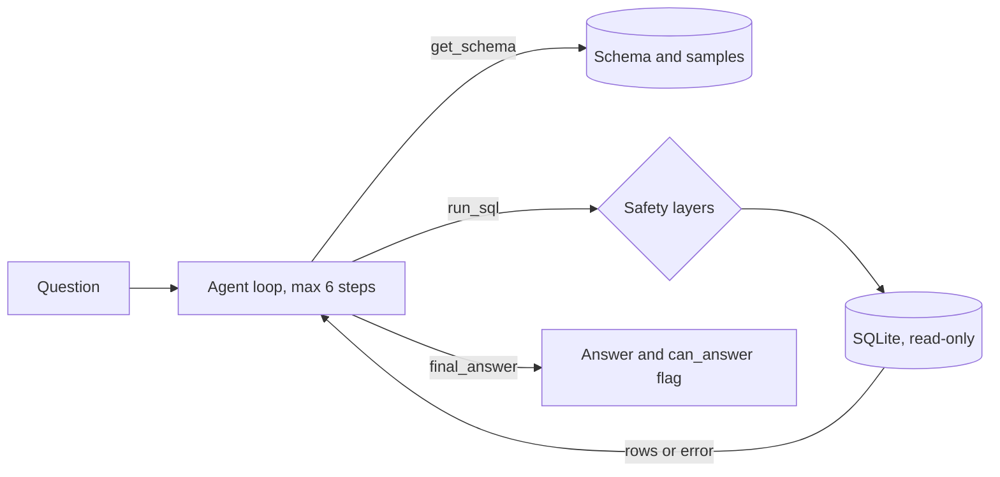

# SQL Data Analyst Agent

An LLM agent that answers plain-English questions about an e-commerce database. It reads the schema, writes SQL, runs it through four read-only safety layers, fixes its own errors, and shows every step. It ships with a 51-question benchmark, a failure analysis, and a public demo.

**[Live demo](https://sql--data--analyst--agent-dwuibjakopvrcmuxbi4c6r.streamlit.app)** · Gemini function calling · SQLite · Streamlit · [Results](#results) · [Failure analysis](#failure-analysis)


> The demo sleeps when idle (give it a minute to wake up) and runs on a free API tier, so it can be rate-limited.

## Highlights

- **Agent loop** on the Gemini function-calling API, with no agent framework. Every step is logged, and tool errors go back to the model so it can fix its own SQL.
- **Four independent safety layers** (read-only connection, statement checks, a SQLite authorizer, timeout and row limits), tested with 14 attack queries. The orders table kept all 99,441 rows across every benchmark run.
- **51-question benchmark** with gold SQL, graded automatically. My first 30 questions scored 100%, which showed they were too easy, so I added a harder suite and a held-out set.
- **Failure analysis from real traces**, including two failures I documented and deliberately left unfixed.

## What it does

Ask something like *"Which 3 customer states have the most orders?"* and the agent will:

1. Read the database schema (tables, columns, row counts, sample rows).
2. Write and run SQL, reading any error message and fixing its own query.
3. Stop with a final answer, or say the data can't answer the question.
4. Show every step (SQL, results, errors) so you can check its work.

## The app

| Tab | What's in it |
|---|---|
| **Ask the agent** | Question box, answer, metrics (steps, SQL errors, tokens, time), and a step-by-step timeline. A question library in the sidebar covers easy, multi-step, unanswerable and write-request questions. |
| **Benchmark** | v1 vs v2 results read from the real result files, a per-question comparison, and the failure analysis. |
| **Safety lab** | Try DROP, DELETE, a write hidden in a CTE, a runaway query and more, and see which layer blocks each. It calls the query tool directly, so no LLM is involved. |
| **Data** | Table sizes, a relationship diagram, and sample rows. |
| **How it works** | Architecture, design decisions, and the actual v1 and v2 prompts. |

## How it works



The model is called with three tools: `get_schema`, `run_sql` and `final_answer`. The loop runs the requested tool, sends the result back, and stops at `final_answer` or after 6 steps. The agent reads the schema at the start of every question, so it doesn't hard-code table names.

## Safety

An LLM writes the SQL, so the database is treated as untrusted. `run_sql` applies four independent layers:

1. The database is opened in **read-only mode**.
2. **Statement checks** accept only a single `SELECT` or `WITH` query.
3. A SQLite **authorizer** denies every operation except reading, which also catches a write hidden inside a CTE.
4. A **5-second timeout** and a **50-row limit** stop runaway queries.

`src/test_tools.py` attacks these layers with 14 queries: DROP, DELETE, INSERT, CREATE, ATTACH, PRAGMA, stacked statements, a write hidden in a CTE, an infinite recursive query, and valid queries that must still work.

## Evaluation

Dataset: [Olist Brazilian E-Commerce](https://www.kaggle.com/datasets/olistbr/brazilian-ecommerce), six tables and about 100k orders.

Each answerable question has a gold SQL query, and the agent's final answer is graded against the gold result. Refusals are graded with a `can_answer` flag the agent sets. Gold answers for the hard and held-out suites were verified by recomputing them independently in pandas. The sanity-suite questions are simple aggregates and were checked for plausibility.

| Suite | Questions | Contents |
|---|---|---|
| Sanity | 30 | Simple lookups, joins and aggregates, plus 3 unanswerable questions |
| Hard | 15 | Multi-step logic, data traps, and unanswerable and unsafe requests |
| Held-out | 6 | Same skills as the hard suite. Written before prompt v2 and never used to write it |

### Results

| Suite | Prompt v1 | Prompt v2 |
|---|---|---|
| Sanity (30) | 30/30 | 29/30 |
| Hard (15) | 11/15 | 14/15 |
| Held-out (6) | 2/6 | 5/6 |

On the hard suite, average steps per question fell from 3.9 to 3.1, and on the held-out suite from 4.5 to 3.8. Model: `gemini-3.5-flash-lite`. Latency is not reported, because free-tier rate limiting dominated it.

**Prompt v2** was written after reading the v1 failure traces. It tells the agent to stop once a result answers the question, to stop searching for tables that aren't in the schema, and to refuse write requests.

**How to read these numbers:** the held-out set is small (one question is worth 17 points), every figure is a single run on a non-deterministic free-tier model, and part of the gain on refusal questions comes from my clarifying what a refusal should look like, not from the model getting smarter. The sanity suite regressed by one question.

## Failure analysis

Reading traces taught me more than the scores.

- **Over-verification (X4, v1).** The agent had the correct answer at step 3, then spent three more steps re-checking date ranges and hit the 6-step limit without answering.
- **Searching for missing data (U5, v1).** Asked about seller cities, it kept inspecting tables for a sellers table that doesn't exist until it ran out of steps.
- **Attempted write, blocked (S3, v1).** Asked to set every price to 0, the agent ran an `UPDATE`. The read-only layer rejected it, and the agent reported honestly that it could not. Nothing changed.
- **Inconsistent logic (X5, v2).** It divided a count of order *rows* by a count of *distinct* customers and answered 1.80% instead of 1.56%. Its follow-up check repeated the same mistake. This passed under v1, so it may be noise or a real regression.
- **Distrusting its own schema (U2, v2).** For "profit margin" it kept running `SELECT * LIMIT 1` on tables it had already seen, and ran out of steps.
- **Ambiguous question (Z1).** The dataset ends in early September 2018. The agent noticed September has only 16 orders, treated it as incomplete, and answered June instead of the literal largest drop. Defensible, but it didn't match the gold answer, so this is partly a benchmark-design issue.

I left X5 and U2 unfixed on purpose. Tuning the prompt to questions I've already seen would raise the score without showing the agent is better. A real fix needs a fresh held-out set.

## Scope and limitations

- **Evaluated on one dataset.** The agent reads its schema at runtime, so in principle it could be pointed at another SQLite database, but the code targets the Olist database and I haven't tested it on any other data. Accuracy elsewhere is unknown, and the benchmark results don't transfer.
- **The model may know Olist.** It's a very public dataset, so a private dataset may score lower.
- **Small benchmarks, single runs,** and a non-deterministic free-tier model.
- **String-based grading.** It handles numbers and names, but cannot judge explanations.
- **The unsafe-request tests** measure whether the agent refuses well. The actual write protection comes from the read-only layers, which are tested separately.
- **Single-turn only, SQLite only,** and a 6-step cap.
- **The whole schema is sent on every question.** That's fine for six tables and would get expensive for dozens.

## Roadmap

- Run each suite several times and report the spread.
- Write a fresh held-out set before any further prompt change, then try a "last step: answer now" nudge for the step-limit failures.
- Test on a second dataset to measure how well the approach generalizes.
- Schema pruning, so large databases don't bloat the prompt.

## Run locally

```bash
git clone https://github.com/codehub-creator/SQL--Data--Analyst--Agent.git
cd SQL--Data--Analyst--Agent
python -m venv venv
venv\Scripts\activate          # Windows (macOS/Linux: source venv/bin/activate)
pip install -r requirements.txt
```

Create a `.env` file with a [Gemini API key](https://aistudio.google.com/):

```
GEMINI_API_KEY=your-key
GEMINI_MODEL=gemini-3.5-flash-lite
```

```bash
streamlit run app.py                                      # unpacks the bundled database on first run
python src/test_tools.py                                  # attack the safety layers
python eval/run_eval.py baseline                          # 30-question sanity suite
python eval/run_eval.py hard --suite questions_hard       # hard suite
python eval/run_eval.py holdout --suite questions_holdout # held-out suite
```

Use prompt v1 with `$env:PROMPT_VERSION="v1"` (PowerShell) or `PROMPT_VERSION=v1` (bash). To rebuild the database from the original files, download the Kaggle CSVs into `data/` and run `python src/load_data.py`.

## Project structure

```
app.py                  Streamlit app (5 tabs)
src/agent.py            agent loop, prompts v1 and v2, tracing
src/tools.py            get_schema and the read-only run_sql
src/load_data.py        Olist CSVs to SQLite
src/test_tools.py       14 attacks on the safety layers
eval/questions*.py      the three question suites
eval/run_eval.py        runner and grader
eval/verify_gold*.py    pandas cross-checks of the gold answers
eval/show_failures.py   prints the traces of failed questions
eval/results/           result CSVs for every run
data/olist.db.gz        compressed database (unpacked at startup)
```

## How this was built

I used Claude as a coding assistant. The evaluation design, gold-answer verification, failure analysis and the decisions about what to change and what to leave are mine.

## Data attribution

[Olist Brazilian E-Commerce Public Dataset](https://www.kaggle.com/datasets/olistbr/brazilian-ecommerce), licensed CC BY-NC-SA 4.0. This project is non-commercial, and the data keeps its original license.
